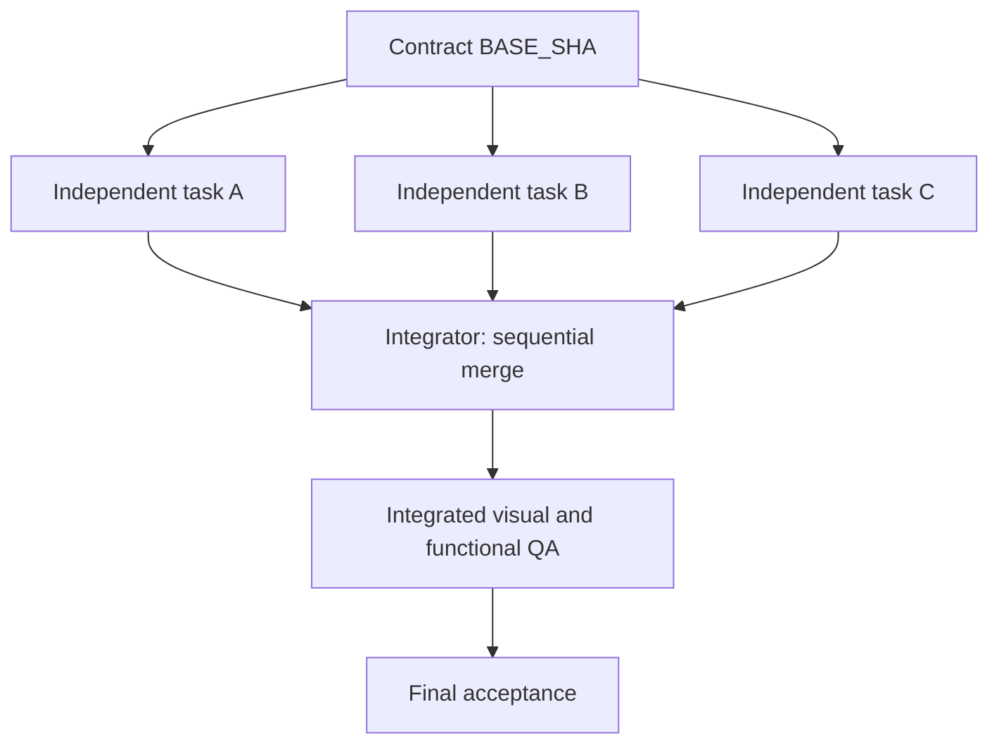

# Multi-Codex orchestration — explicit DAG, isolation, no false statuses

## Why multiple agents
Use concurrency only when total wall-clock savings outweigh context, integration, QA and conflict cost. More agents do not guarantee higher quality. Default **one**; 2–3 for three independently specified scopes; exceed three only with measured capacity, budgets and clean ownership.

### Delegation gate (ALL true)
- Sufficient volume or genuinely independent, time-consuming task;
- completely specified with exact inputs/outputs and objective test plan;
- safe to expose necessary code/context to Codex provider, operator consent recorded;
- git worktree/branch isolation and exclusive writable files;
- no unresolved shared design/architecture decisions;
- tool/permission limits supported; no production secrets/DB side effects.
If a task fails the gate, the art director resolves its specification or sequencing before delegating; a small implementation may use a single Codex run.

## DAG construction
List vertices `TASK-ID`; edge `A -> B` means B REQUIRES A **integrated** (not merely Codex-completed). A shared contract commit is root `BASE_SHA`. Mark integration tasks as explicit vertices. Group independent tasks into batches where:
1. All dependencies are already integrated into `BASE_SHA`.
2. Task writable file sets are disjoint (including snapshots, tokens, `package.json`, lockfiles, assets and generated outputs).
3. Task APIs are fixed by architecture contract; no cross-agent direct file edits.
4. Shared visual tokens are frozen and available in every branch.
5. Tests for each task are runnable in its branch, or explicitly assigned to integrated QA (not reported passed early).

**Dependency graph:**



## File ownership
Create a matrix of `owner -> paths`. Shared root files are writable ONLY by the integrator. Worktree isolation guards simultaneous changes to the same filesystem, **not** integration conflicts. Post-run run `git diff --name-only BASE_SHA`, `git status --short`, and compare changes against allowed paths (no blind trust of prompt instructions). Reject scope violations; do not merge automatically.

## Worktree and branch protocol
- Verify `git status --porcelain` clean or explicitly preserve any user changes first; never stash/reset/destroy uncommitted work without permission.
- Create a unique branch and worktree per task from common reviewed `BASE_SHA`, e.g. `git worktree add -b codex/TASK-101 ../project-codex-worktrees/TASK-101 <sha>`.
- Codex runs in worktree with task prompt via STDIN. Capture log, exit code, full diff, changed-file scope and final message.
- `exit 0` means *execution ended*, not code quality approved. Worker state becomes `CODEX_REPORTED` or `FAILED`; review then `TESTED`, `VISUALLY_REVIEWED`, `ACCEPTED`.
- Integrator checks each diff, tests, screenshots, applies accepted changes sequentially through chosen Git merge/cherry-pick workflow, resolves integration manually, and reruns full app tests + final screenshots. **Never merge on agent claims alone.**
- New dependent task batch must start from the **new integrated commit**, not the old shared baseline. Avoid cross-batch stale bases.

## Contention and resource budget
- At most one task owns an entrypoint/shared CSS/config/lockfile on a wave.
- For same-file edits prefer sequential owner and rapid review instead of “parallel” agents negotiating.
- One integration checkpoint per wave, bounded retries (two correction iterations by default); keep exact issue IDs.
- Control network/API cost and workspace disk use; dispose worktrees after explicit approval and only when no uncommitted work is at risk.
- Runner does not have authority to auto-deploy, run schema migrations or delete environments.

## Status contract
- `PLANNED`: work order exists; not executed.
- `DISPATCHED`: process successfully launched; not necessarily complete.
- `FAILED`: nonzero exit or unsafe scope; needs investigation.
- `CODEX_REPORTED`: exit zero and report captured, no independent verification.
- `TESTED`: specified tests rerun by reviewer with recorded results.
- `VISUALLY_REVIEWED`: actual browser screenshots seen at required viewports.
- `ACCEPTED`: contract criteria proven; no blocking findings.
- `INTEGRATED`: accepted changes merged and final regression verified.
- `BLOCKED`: missing consent, contract or tooling; no misleading completion.

## Delegation communication
The task content must be self-contained: Codex agents do not inherit the directing assistant's conversation and may not see all assets. Include exact repo SHA, actual screenshot location, contract summary or copies of relevant values, writable paths, API signatures, AC checkboxes and report format in the task itself.

## Run the dispatcher
From an existing clean Git project, prepare a JSON manifest with `base_sha` and a `tasks` array. Each task needs an `id`, `spec` path, nonempty `allow` list and empty `depends_on` list. Use actual task files and exclusive writable paths; include only tasks whose prerequisites are already integrated.

```bash
python3 /path/to/art-director/scripts/dispatch_codex.py \
  --project /path/to/my-project \
  --manifest /path/to/my-project/docs/art-direction/codex-batch.json

# After reviewing the plan, authorizing external code sharing:
python3 /path/to/art-director/scripts/dispatch_codex.py \
  --project /path/to/my-project \
  --manifest /path/to/my-project/docs/art-direction/codex-batch.json \
  --execute --approve-sharing-code --workers 3
```

The script runs **one independent wave only** and NEVER auto-integrates. If manifest includes dependent tasks or overlapping scopes, fix it before executing. Outputs go to `<project>-codex-runs/` next to the repository; real worktrees also live next to the repository, so generated logs do not dirty the project checkout. On `--execute` it creates worktrees and runs actual CLI processes; no CLI = immediate explicit failure. See `references/codex-cli.md`.

## Escalate to user only for substantial decisions
Example: unlicensed critical asset, unapproved data egress, destructive migration, conflicting brand direction, unaffordable API cost, or mutually exclusive product behaviors. Small reversible implementation choices can be proposed with assumptions and logged; do not block unnecessarily.

## Single-instance resources and context budget
- Photoshop (one app, one active document) and the user's browser (computer use) are **exclusive**: one agent each at a
  time; queue tasks that need them and run tasks with independent tool state in parallel.
- Focus each run on one deliverable and set its generation and usage limits in the task brief. State lives in
  files (selection files, coordinates/boxes, task graph), so each new agent gets a short spec + paths, not history.
- When a run is stopped and restarted, tell the new agent what the old run may have left (open documents, half-written
  files, generated assets) and to reuse or clean only its own artefacts.
- Never dispatch a run that writes to a document the user is editing; save user-edited files as new versions.
