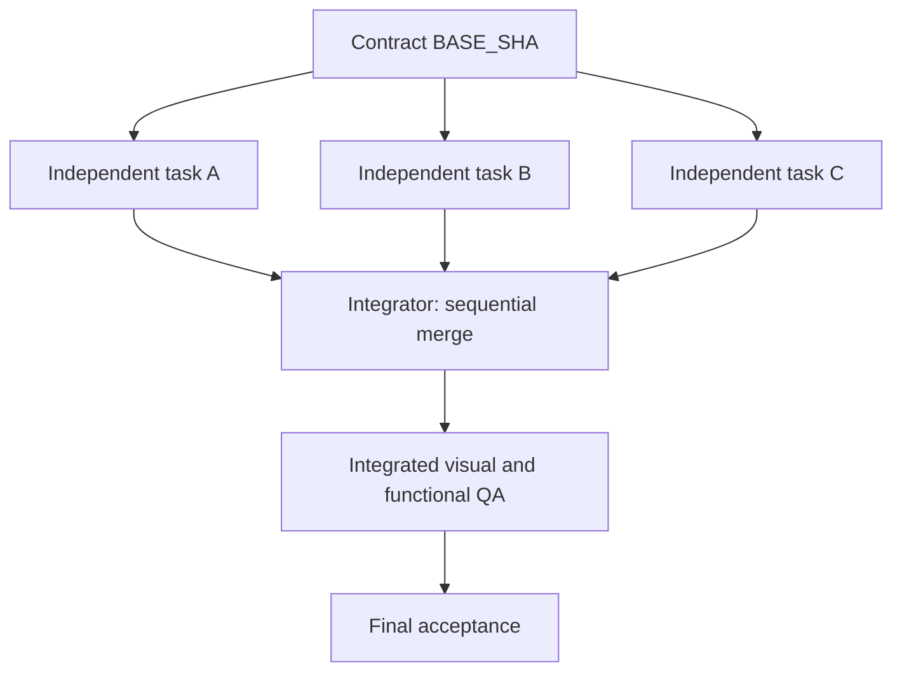

# Multi-Codex orchestration — explicit DAG, isolation, no false statuses

## Why multiple agents
Use concurrency only when total wall-clock savings outweigh context, integration, QA and conflict cost. More agents do not guarantee higher quality. Run independent, fully specified tasks concurrently within the **user's chosen global maximum (default 10)** and per-tool caps; queue extra tasks. Read current `PROJECT-SETUP.md`: default Codex agents only; Claude Code subagents or nested Codex sub-agents require permission at setup. Record policy and never switch silently. Never parallelize tasks that share writable files or a single-instance tool.

### Delegation gate (ALL true)
- Sufficient volume or genuinely independent, time-consuming task;
- completely specified with exact inputs/outputs and objective test plan;
- safe to expose necessary code/context to Codex provider, operator consent recorded;
- git worktree/branch isolation and exclusive writable files for implementation; disjoint batch output directories and a serial merge owner for research/copy/image work without code branching;
- no unresolved shared design/architecture decisions;
- tool/permission limits supported; no production secrets/DB side effects.
If a task fails gate, the orchestrator owns the decision and should clarify/specify/sequence before delegating; a small implementation may be sequential Codex.

## DAG construction
List vertices `TASK-ID`; edge `A -> B` means B REQUIRES A **integrated** (not merely Codex-completed). A shared contract commit is root `BASE_SHA`. Mark integration tasks as explicit vertices. Group independent tasks into batches where:
1. All dependencies are already integrated into `BASE_SHA`.
2. Task writable file sets are disjoint (including snapshots, tokens, `package.json`, lockfiles, assets and generated outputs).
3. Task APIs are fixed by architecture contract; no cross-agent direct file edits.
4. Shared visual tokens are frozen and available in every branch.
5. Tests for each task are runnable in its branch, or explicitly assigned to integrated QA (not reported passed early).

**Dependency graph:**



## File ownership
Create a matrix of `owner -> paths`. Shared root files are writable ONLY by the integrator. Worktree isolation guards simultaneous changes to the same filesystem, **not** integration conflicts. Post-run run `git diff --name-only BASE_SHA`, `git status --short`, and compare changes against allowed paths (no blind trust of prompt instructions). Reject scope violations; do not merge automatically.

## Worktree and branch protocol
- Verify `git status --porcelain` clean or explicitly preserve any user changes first; never stash/reset/destroy uncommitted work without permission.
- Create a unique branch and worktree per task from common reviewed `BASE_SHA`, e.g. `git worktree add -b codex/TASK-101 ../project-codex-worktrees/TASK-101 <sha>`.
- Codex runs in worktree with task prompt via STDIN. Capture log, exit code, full diff, changed-file scope and final message.
- `exit 0` means *execution ended*, not code quality approved. Worker state becomes `CODEX_REPORTED` or `FAILED`; review then `TESTED`, `VISUALLY_REVIEWED`, `ACCEPTED`.
- Integrator checks each diff, tests, screenshots, applies accepted changes sequentially through chosen Git merge/cherry-pick workflow, resolves integration manually, and reruns full app tests + final screenshots. **Never merge on agent claims alone.**
- New dependent task batch must start from the **new integrated commit**, not the old shared baseline. Avoid cross-batch stale bases.

## Contention and resource budget
- Read `references/tooling-limits.md`: shared browser profile/computer use/raster editor = 1 each; design tool = 1–2; task tracker/other service connectors ≈5; web research up to global max. Count active workers and nested sub-agents toward global max; a multi-tool task must fit every tool cap.
- Record tool owner, quota/call budget and probe evidence per wave. Prefer one inventory pass then targeted reads/screenshots by saved IDs; reserve verification calls and split task tracker import/read-back across reset windows when needed. See quota-aware scheduling below.
- The included dispatcher is limited to 1–10 workers and does not enforce tool caps. Set workers within the chosen max and split waves; use a verified alternative for a higher user maximum.
- At most one task owns an entrypoint/shared CSS/config/lockfile on a wave.
- For same-file edits prefer sequential owner and rapid review instead of “parallel” agents negotiating.
- One integration checkpoint per wave, bounded retries (two correction iterations by default); keep exact issue IDs.
- Control network/API cost and workspace disk use; dispose worktrees after explicit approval and only when no uncommitted work is at risk.
- Runner does not have authority to auto-deploy, run schema migrations or delete environments.

## Status contract
- `PLANNED`: work order exists; not executed.
- `SCHEDULED`: background retry launcher exists; record PID, log and reset/launch time; Codex has not yet been dispatched.
- `DISPATCHED`: process successfully launched; not necessarily complete.
- `FAILED`: nonzero exit or unsafe scope; needs investigation.
- `CODEX_REPORTED`: exit zero and report captured, no independent verification.
- `TESTED`: specified tests rerun by reviewer with recorded results.
- `VISUALLY_REVIEWED`: actual browser screenshots seen at required viewports.
- `ACCEPTED`: contract criteria proven; no blocking findings.
- `INTEGRATED`: accepted changes merged and final regression verified.
- `BLOCKED`: missing consent, contract or tooling; no misleading completion. For quota/approval blocks list exact unverified artifacts/operations and verified resume time, or UNKNOWN plus the action needed.

## Delegation communication
Reference current setup path/version and include applicable agent, tool, confidentiality, tone and sender rules in every task packet. Persist new client decisions in project docs and orchestrator memory immediately.
The task content must be self-contained: Codex agents do not inherit the orchestrator's full chat and may not see all assets. Include exact repo SHA, actual screenshot location, contract summary or copies of relevant values, writable paths, API signatures, AC checkboxes and report format in the task itself.

## Run the dispatcher
From an existing clean Git project, prepare a JSON manifest with `base_sha` and a `tasks` array. Each task needs an `id`, a real `spec` path, a nonempty `allow` list and an empty `depends_on` list. Include only tasks with integrated prerequisites and exclusive writable paths:

```bash
python3 /path/to/art-director/scripts/dispatch_codex.py \
  --project /path/to/my-project \
  --manifest /path/to/my-project/docs/art-direction/codex-batch.json

# After reviewing the plan, authorizing external code sharing:
python3 /path/to/art-director/scripts/dispatch_codex.py \
  --project /path/to/my-project \
  --manifest /path/to/my-project/docs/art-direction/codex-batch.json \
  --execute --approve-sharing-code --workers 10
```

The script runs **one independent wave only** and NEVER auto-integrates. If manifest includes dependent tasks or overlapping scopes, fix it before executing. Outputs go to `<project>-codex-runs/` next to the repository; real worktrees also live next to the repository, so generated logs do not dirty the project checkout. On `--execute` it creates worktrees and runs actual CLI processes; no CLI = immediate explicit failure. See `references/codex-cli.md`.

## Project scaffold — local files, no dispatch
Use the dependency-free `scripts/new_project.py` for a new project folder:

```bash
python3 /path/to/art-director/scripts/new_project.py --project /path/to/project --effort high --dry-run
python3 /path/to/art-director/scripts/new_project.py --project /path/to/project --effort high
```

It creates `<project>/docs/art-direction/PROJECT-SETUP.md` from `templates/project-setup.md`, plus **root-level** `tasks/`, `findings/`, `runs/` and executable `dispatch.sh`. Existing files are preserved; dry-run prints CREATE/SKIP actions and writes nothing. The setup remains PROPOSED until Gate −1 is completed; scaffold creation grants no execution/sharing permission. Use existing project conventions rather than duplicating them.

Put a self-contained permitted work order in `tasks/<T>.md`. Preview with `./dispatch.sh --dry-run <T> [effort]`; after the existing consent/preflight gates, run `./dispatch.sh --execute --approve-sharing-code <T> [effort]`. The wrapper invokes:

```bash
codex exec -C <project> --sandbox workspace-write --skip-git-repo-check \
  -c sandbox_workspace_write.network_access=true -c web_search=live \
  -c model_reasoning_effort=<e> -o runs/<T>/report.txt - < tasks/<T>.md
```

The wrapper checks the task ID/effort and refuses an existing run directory. It saves stdout/stderr, appends **`<T> exit=<code>`** to `runs/status.log`, prints the `tokens used` line/count when emitted, and returns Codex's exit code. A new retry uses a fresh task/run ID linked to the original checkpoint. Verify local CLI flags, supported effort and network permission before use. It has **no ownership enforcement or worktree isolation**: use it for disjoint research/image/other non-code outputs or a permitted sequential task. Concurrent code implementation still requires the worktree dispatcher/protocol above; this helper does not replace it.

## Background quota retry — sleep, then dispatch
Follow `references/tooling-limits.md`: obtain the verified reset time, add a small margin, prepare a **remaining-work-only** task with saved entity/section IDs, call budget, current setup/version, re-probe and stop conditions. Reserve its tool slot at launch; queue conflicting waves. Schedule only work within recorded authorization and caps. A retry gets a fresh ID, e.g. `VERIFY-001-R1`.

Illustrative POSIX shell, with `retry_delay_seconds` calculated from the verified reset + margin and `project_root` set to the absolute scaffold project path:

```bash
nohup sh -c 'sleep "$1" && exec "$2" --execute --approve-sharing-code "$3"' quota-retry \
  "$retry_delay_seconds" "$project_root/dispatch.sh" VERIFY-001-R1 \
  > "$project_root/runs/VERIFY-001-R1-scheduler.log" 2>&1 < /dev/null &
retry_pid=$!
printf 'scheduled pid=%s\n' "$retry_pid"
```

Record reset/launch time (timezone + UTC), task ID, **actual launcher PID**, log and cancellation command (`kill <scheduler-PID>` before dispatch) in the run ledger. Confirm the launcher was spawned; report SCHEDULED, not DISPATCHED. Continue independent work instead of a foreground sleep. Re-read current setup and stop if authorization/scope changed before operations; record real Codex launch/exit evidence when it runs. Allow one retry per scheduled reset; another exhaustion returns BLOCKED with a new verified reset, not an unbounded retry loop. If background survival or reset time cannot be established, leave a ready packet and say scheduling NOT RUN.

## Escalate to user only for substantial decisions
Example: unlicensed critical asset, unapproved data egress, destructive migration, conflicting brand direction, unaffordable API cost, or mutually exclusive product behaviors. Small reversible implementation choices can be proposed with assumptions and logged; do not block unnecessarily.

## Single-instance resources and context budget
- The raster editor (one app, one active document) and each automation browser profile are **exclusive**: one agent each at a time; queue tasks that need them. Keep the user's main browser free for web-generator work; see `references/tooling-limits.md`. Run Python image-processing/file tasks within global max and design-tool tasks within the 1–2 cap and quota budget.
- Focus each run on one deliverable and apply the generation and usage limits in PROJECT-SETUP. State lives in
  files (selection files, coordinates/boxes, task graph), so each new agent gets a short spec + paths, not history.
- When a run is stopped and restarted, tell the new agent what the old run may have left (open documents, half-written
  files, design tool nodes) and to reuse or clean only its own artefacts.
- Never dispatch a run that writes to a document the user is editing. If the client changes a working file, stop all agents touching it, save the client's state as a new version and use that version as the approved base; update queued tasks before resuming.
