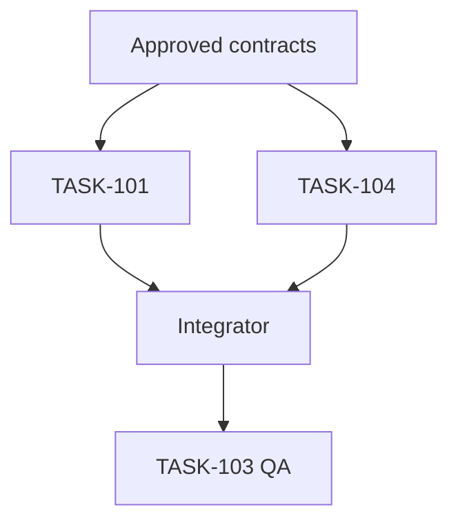

# TASK-GRAPH — [Project], contract BASE_SHA=[SHA]

## DAG (edge A -> B means A must already be integrated before B starts)

| Task ID | Depends on INTEGRATED | Exclusive writable paths | Estimated effort/risk | Planned wave |
|---|---|---|---|---|
| TASK-101 | BASE_SHA | ... | ... | 1 |

## Concurrency justification
- Tasks in same wave are independent because:
- Paths that might overlap and designated sole owner:
- Why sequential tasks are sequential:
- Default worker count and cap:
- Data-transfer approval status:
- Stop conditions / fallback:

## Integration and evidence
- Integrator name/role:
- Merge acceptance gate and regression commands:
- Final QA wave:
